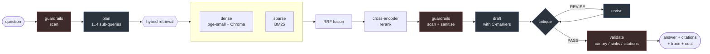

# ml-agentic-research-assistant

A research assistant that answers from a licence-filtered arXiv corpus: hybrid
retrieval with a reranker, a LangGraph agent that plans, uses tools, critiques
its own draft and revises it, citation grounding that is **measured** rather
than asserted, and prompt-injection guardrails with an adversarial suite they
have to pass.



**Everything runs from one command, on a clean machine, with no API key:**

```bash
docker compose up
```

That starts a local Ollama, fetches the 12 CC-BY licensed arXiv papers the
published results were measured on, builds the indexes, and serves a streaming
API on `http://localhost:8000`. First run downloads a model and the corpus, so
give it time; every run after is instant. `ARAA_CORPUS_TARGET_DOCS` in `.env`
fetches a bigger corpus, after which the published numbers no longer apply.

---

## Why there is no API key in the quickstart

Every quantitative claim below has to be reproducible by someone who just
cloned this. If the default path needed a paid key, "reproducible" would mean
"reproducible if you spend money" and you would be taking the numbers on trust.

So generation runs on local open weights (Ollama), and embedding and reranking
run on local MIT-licensed models. The whole eval suite costs nothing.

## Your documents never leave your network

In the default deployment generation, embedding and reranking all run on
hardware you control. No document, question or answer is sent to a third-party
model service, so a confidential corpus stays inside your network. That matters
to anyone whose documents are legal, medical, commercial or simply unpublished:
there is no third-party data processing agreement to negotiate, because there
is no third party in the loop.

The generation backend is pluggable through one provider interface. The
`openai_compat` backend speaks the OpenAI-compatible chat completions protocol.
That covers a self-hosted vLLM or llama.cpp server on a GPU box down the
corridor as well as a hosted API, with no code change:

```bash
ARAA_LLM_BACKEND=openai_compat
ARAA_OPENAI_BASE_URL=http://gpu-box:8000/v1   # vLLM, llama.cpp, LM Studio, Ollama /v1, OpenAI...
ARAA_OPENAI_MODEL=llama3.1:8b
# Hosted endpoints only: the key's env var and the price for cost accounting
ARAA_OPENAI_API_KEY_ENV=OPENAI_API_KEY
ARAA_OPENAI_INPUT_USD_PER_MTOK=0.0
ARAA_OPENAI_OUTPUT_USD_PER_MTOK=0.0
```

Its base URL defaults to the local Ollama's `/v1` route, so switching backend
sends nothing off the machine until you point it somewhere else on purpose. The
API key is read from the environment variable you name rather than stored as a
setting. Per-token prices are configuration, so the cost ledger reports real USD
for a hosted model and 0.00 for a local one.

---

## Results

Full generated report: **[docs/results.md](docs/results.md)**, rendered by
`python -m evals.report` from the committed
**[docs/results.json](docs/results.json)**. That file is condensed from the raw
eval artefacts in `data/runs/` (gitignored, regenerated by `make eval`) and
records each artefact's SHA-256, run time and configuration. Nothing is typed by
hand. CI fails if `docs/results.md` differs from what `docs/results.json`
renders, and `tests/test_results_doc.py` fails if a figure quoted in this README
differs from `docs/results.json`.

### The headline finding: the agent loses to the baseline

Both paths answer the same 10 questions. The agent plans, uses tools, critiques
its own draft and revises it. The baseline retrieves once and answers once.

| | `single_shot` | `agent` |
| --- | ---: | ---: |
| Citation support rate (LLM judge) | **62.1%** | **26.9%** |
| Citation support rate (lexical floor, model-independent) | **65.5%** | **50.0%** |
| Hallucination rate (lower is better) | **57.1%** | **80.0%** |
| Tokens per query | 1,573 | 13,259 |

**The agent grounds worse than one-shot RAG, at 8.4x the tokens.** Two judges
that share no machinery agree on the direction. Nothing about "planning, tool
use and self-critique" made the citations more trustworthy on this corpus: it
made them less so.

At 29 and 26 judged claims the intervals are wide and overlap slightly, so treat
this as a strong signal rather than a settled result. The mechanism is visible
in the traces: the revision step rewrites claims to satisfy the critic, and a
reworded claim drifts away from what its cited passage actually says. Critique
and revision are also **76.5% of the agent's tokens**, so the expensive part of
the agent is the part making it worse.

That is an unflattering result about the headline feature of this repository,
produced by its own eval harness, reported here rather than buried. It is the
entire reason the baseline runs in the same eval. Next step would be constraining
the reviser to edit citations rather than prose, and re-measuring, not shipping
the agent as the default because it sounds more sophisticated.

### What else has been measured

**Retrieval** (`make eval-retrieval`): 12-paper corpus, 2,213 chunks, 36 deterministic queries:

| Configuration | doc hit@3 | chunk hit@5 | latency |
| --- | ---: | ---: | ---: |
| vector only | 91.7% | 91.7% | 621 ms |
| BM25 only | 91.7% | 91.7% | 18 ms |
| hybrid (RRF) | 94.4% | 100.0% | 483 ms |
| **hybrid + reranker** | **97.2%** | **100.0%** | 6735 ms |

**Reranker lift over vector-only: +6.0% relative on doc hit@3**, for
**+6.3 s/query** on CPU, which is the honest other half of that sentence.

At n=36 the 95% confidence intervals overlap, so this ordering is suggestive,
not significant. The eval says so itself rather than leaving you to notice.

**Guardrails** (`make eval-adversarial`, tier 1: deterministic, runs in CI):

| | |
| --- | ---: |
| Attack detection rate | **100%** (21/21) |
| Block rate on must-block attacks | **100%** (11/11) |
| **False positives on benign controls** | **0%** (0/6) |

That last row is the one that matters. This corpus is computer-science papers,
some of which are *about* prompt injection.

**Chunking** (`make eval-chunking`): four strategies, same corpus, same queries,
one isolated index each:

| Strategy | Chunks | **doc hit@3** | chunk nDCG@10 | Context tokens |
| --- | ---: | ---: | ---: | ---: |
| `fixed` | 2176 | **91.7%** | 0.689 | 879 |
| `recursive` (default) | 2213 | **91.7%** | 0.639 | **859** |
| `sentence_window` | 5020 | **91.7%** | 0.348 | 1319 |
| `section_aware` | **708** | **91.7%** | 0.689 | 1643 |

**All four tie.** On this question set chunking makes no measurable difference
to whether the right document is retrieved, so the choice is a cost decision and
`recursive` keeps the default on context cost. The nDCG column looks like it
disagrees and is a trap: see [the write-up](docs/corpus.md#what-it-actually-found).

**Cost** (`make eval-cost`): per query, provider-reported token counts:

| | `single_shot` | `agent` |
| --- | ---: | ---: |
| LLM calls | 1.00 | 8.00 |
| Total tokens | 1,543 | 13,006 |
| Wall time | 9.4 s | 51.1 s |
| Projected $/1k queries at a hosted price point ($1 in, $5 out per Mtok) | $2.05 | $17.68 |

The agent uses **8.4x the tokens** of the baseline, and **76.5% of the agent's tokens
go to critique and revision** (critique 43.8%, revise 32.7%, draft only 12.6%).
That is the number to weigh the groundedness delta against: self-critique is
most of the bill, not the answer.

---

## Read these three things

If you only look at three files, look at the places where a measurement changed
the design:

1. **[docs/results.md](docs/results.md)**: the generated numbers, including the
   one that says the agent is the wrong default.
2. **[docs/architecture.md](docs/architecture.md)**: the bugs the evals caught
   that reading the output never would have.
3. **[evals/adversarial/attacks.yaml](evals/adversarial/attacks.yaml)**: the
   attack suite, and the benign controls that stop the guardrails from becoming
   useless.

### The metric that was wrong

Scored on chunk-level nDCG@10, the reranker looks like a loss: in the committed
results it has a chunk nDCG@10 of 0.639 against 0.679 for vector only, and an
earlier run (whose artefact was not kept) made it look worse still. The gold set
for the deterministic questions is document-level (~100 relevant chunks per
query), and chunk-level nDCG@10 over a gold set that large does not measure
ranking. It rewards returning ten chunks from one paper, and *penalises* a
reranker for surfacing the best passage alongside diverse context. On the same
queries doc hit@3 went from 91.7% to 97.2%.

The nDCG figure was not evidence the reranker hurt. It was evidence the metric
did not match the gold. Headline metrics are now selected per question set
([`run_retrieval_eval.py`](evals/retrieval/run_retrieval_eval.py)), and both are
reported.

### The guardrail that was too aggressive

The adversarial suite includes benign controls: passages a real corpus contains
that a naive detector will flag. One is a paper describing prompt injection:

> Prior work shows that instructions embedded in retrieved documents can
> override a model's system prompt.

The first version of the rules **blocked it**, at critical severity. On a
corpus of computer-science papers that makes the system unusable, and no attack
test would ever have caught it. The fix discriminates on grammatical mood (a
paper *describes* an attack, an injection *issues* one) rather than on
vocabulary, and it does not defuse a real imperative that happens to be prefixed
with academic framing. Both cases are pinned in
[`tests/test_guardrails.py`](tests/test_guardrails.py).

### The failure that raised nothing at all

The planner's prompt included the tool inventory. So the planner emitted this
as its "sub-queries":

```
search_corpus query="measurement methods comparison" top_k=10
lookup_document doc_id="2103.01101
```

Those strings went into the retriever **as literal search text**. The request
returned HTTP 200, produced a cited answer, logged no warnings, tripped no
guardrail, and every one of the nine retrieved passages came from the same
paper. No exception, no failing metric, just retrieval quietly performing far
worse than it should while looking entirely healthy.

Tool selection is now a separate node with its own prompt, the planner never
sees the tool list, and [`_parse_plan`](src/araa/graph/nodes.py) salvages the
search intent from any line that still looks like a function call. Same
question, same corpus, before and after (from two traced requests read by hand,
not from an eval artefact, so these counts are not in `docs/results.json`):

| | Before | After |
| --- | --- | --- |
| Plan | `search_corpus query="measurement methods" top_k=10` | `evaluation metrics in natural language processing` |
| Tool calls executed | 0 | 6 (4 succeeded, 2 returned errors) |
| **Distinct source documents cited** | **1** | **3** |

This is the one that makes the argument. A demo hides it. Only running the thing
and reading the trace finds it.

(The two failed tool calls are also working as designed: the model invented
document ids, and `lookup_document` returned "no document X in the corpus" as a
tool error the drafter could see, rather than raising.)

---

## What is here

| Layer | Built | Verified how |
| --- | --- | --- |
| Corpus fetch, licence-filtered | yes | 12 papers fetched, every one with a recorded licence |
| PDF parsing (2-column order, sections, tables) | yes | 2,213 chunks from 12 papers |
| Tabular parsing + queryable dataframe | yes | metadata table indexed and tool-queryable |
| Four swappable chunking strategies | yes | unit tests per strategy; comparison harness written |
| Hybrid retrieval + RRF + cross-encoder rerank | yes | measured, table above |
| Single-shot RAG with citation grounding | yes | end-to-end against a live model |
| LangGraph agent (plan, tools, critique, revise) | yes | end-to-end against a live model |
| Injection guardrails + adversarial suite | yes | 100% detection, 0% false positives |
| Streaming FastAPI service | yes | routes served, SSE for both modes |
| Scheduled re-ingestion + digest reports | yes | APScheduler service in compose |
| Token and cost accounting per query | yes | provider-reported counts, attributed per node |
| **AWS Terraform / Lambda** | **written, never applied** | `terraform validate` + `fmt` in CI only |

---

## Using it

```bash
# structured JSON: answer, citations, retrieval trace, cost, guardrails
curl -X POST localhost:8000/ask \
  -H 'Content-Type: application/json' \
  -d '{"question": "What do these papers measure?"}' | jq

# the agent, opt-in: plan, tools, self-critique, revisions in the response
curl -N -X POST localhost:8000/ask/stream \
  -H 'Content-Type: application/json' \
  -d '{"question": "What do these papers measure?", "mode": "agent"}'
```

> **`mode` defaults to `single_shot`, not `agent`.** That is a direct
> consequence of the groundedness result above: the agent grounds worse at 8.4x
> the tokens, so it is opt-in until that is fixed. Changing the default is what
> acting on a measurement looks like.

| Endpoint | |
| --- | --- |
| `GET /health` | index, corpus, model reachability, guardrail config |
| `GET /corpus` | document count and the licence breakdown |
| `GET /tools` | the tool inventory |
| `GET /runs/latest` | most recent ingestion run |
| `POST /ask` | structured JSON result |
| `POST /ask/stream` | SSE: tokens for `single_shot`, stage events for `agent` |

Or from the CLI:

```bash
araa status
araa ask "What retrieval methods do these papers compare?"
araa ask --mode agent --json "..." | jq '.plan, .revisions, .cost'
```

### Locally, without Docker

```bash
./scripts/setup.sh      # needs Python 3.11+
make corpus             # fetch the 12-paper CC-BY corpus (rate-limited, 3 s per PDF)
make ingest
make eval report        # every number in docs/results.json and docs/results.md
make serve
```

---

## Configuration

Every input is an environment variable: see [`.env.example`](.env.example). The ones that change results:

| | Default | |
| --- | --- | --- |
| `ARAA_LLM_BACKEND` | `ollama` | `ollama` \| `openai_compat` \| `fixture` |
| `ARAA_CHUNK_STRATEGY` | `recursive` | `fixed` \| `recursive` \| `sentence_window` \| `section_aware` |
| `ARAA_FINAL_TOP_K` | `6` | passages given to the model |
| `ARAA_USE_RERANKER` | `true` | the +6.0% doc hit@3 for +6.3 s/query trade |
| `ARAA_MAX_CRITIQUE_ROUNDS` | `2` | agent revise loop cap |
| `ARAA_GUARDRAIL_BLOCK_ON_DETECT` | `true` | refuse vs. annotate on critical detection |
| `ARAA_INGEST_CRON` | `15 3 * * *` | scheduled re-embedding |
| `ARAA_CORPUS_TARGET_DOCS` | `12` | papers fetched; 12 is the published corpus |

Every eval artefact records the full configuration that produced it, so a number
can always be traced back to the run that made it.

---

## Limitations

Stated plainly, because a project whose whole argument is "measure it" cannot
have a vague limitations section.

**The corpus behind the numbers above is 12 papers.** Adequate for validating
the pipeline and for comparing configurations against each other; too small to
generalise from. The default fetch is the same 12 (`ARAA_CORPUS_TARGET_DOCS`),
with the same arXiv window; a metadata-only fetch on 2026-10-16 returned the
same 12 arXiv ids. arXiv's OAI-PMH window filters on a record's last metadata
change, so a later fetch can return a different 12 if any of those papers is
updated.

**n=36 queries means the retrieval differences are not statistically
significant.** The eval computes Wilson intervals and flags overlap, and at this
sample size a one or two question difference moves the headline by 3 to 6 points. Treat the
ordering as suggestive and the magnitudes as noise until it runs on the full
corpus.

**The deterministic question set is easier than real research questions.** A
query is a sentence from a paper's abstract and the gold is that paper's body,
so absolute recall is optimistic. It is a fair *comparison* between retrieval
configurations (every configuration faces identical queries), but it is not a
measure of how the system handles a question a person would actually ask. The
LLM-generated set exists for that and is harder.

**The groundedness judge defaults to the same model that wrote the answer.**
A model grading its own output is a sympathetic judge. A deterministic
lexical-overlap judge runs alongside as a model-independent floor and their
agreement rate is reported. The honest fix is a different judge model
(`--judge-backend openai_compat` with `ARAA_OPENAI_MODEL` set to it). The report
prints a warning whenever judge and author match.

**The headline agent-vs-baseline result rests on 29 and 26 judged claims.**
The 95% intervals are wide and overlap slightly. What raises it above a
curiosity is that two judges sharing no machinery (an LLM and a lexical overlap
score) agree on the direction and the rough magnitude. Treat it as a strong
signal to act on, not a settled number, and re-run it at corpus scale before
quoting it anywhere that matters.

**Absolute groundedness numbers are low for both modes** (62% and 27% support;
57% and 80% hallucination). Some of that is a genuinely strict judge (a claim
that overstates its passage scores PARTIAL, which counts as unsupported) and
some is an 8B model being asked to attribute carefully. The *comparison* between
modes is the load-bearing part; the absolute levels would move a lot on a
stronger generator, which is one env var away.

**Guardrails are not a solved problem and this suite is not exhaustive.** 100%
on 21 attacks means the suite is passed, not that the system is secure. The
structural defence (fenced untrusted content, an explicit trust hierarchy, a
read-only tool inventory, output validation with a canary) is doing more work
than the rule list, and is designed to degrade better when an unanticipated
payload arrives.

**The Terraform has never been applied.** It is `terraform validate`d and
`fmt`ed in CI, and that is the whole extent of its verification. The scheduled
ingestion that actually runs is the APScheduler worker in compose. Both call the
same entry point, so they cannot drift, but only one of them has run.

**Latency figures are hardware-bound and mostly meaningless as benchmarks.** The
development box had its GPU occupied, so everything ran on CPU. The quality
numbers are hardware-independent; the millisecond columns are not.

**PDF parsing is heuristic.** Two-column reading order, section-heading
detection and table extraction all work on the arXiv papers tested and will meet
a layout they mishandle. Failures are counted in the ingestion run log rather
than hidden: `documents_failed` is a field, not a log line.

---

## Testing

```bash
make test          # 274 tests, no model, no corpus, no external network
make report-check  # docs/results.md must match docs/results.json
make lint
make tf-validate
make e2e           # integration test against a running stack
make e2e-mock      # destroy volumes, docker compose up with the mock generator, assert the lot
make e2e-cold      # the same with the real Ollama model
```

**No test or workflow calls a paid API.** Unit tests run with
`ARAA_LLM_BACKEND=fixture` and an in-process `httpx.MockTransport`.
[`tests/test_mock_openai_server.py`](tests/test_mock_openai_server.py) runs the
`openai_compat` backend over a real socket against
[`scripts/mock_openai_server.py`](scripts/mock_openai_server.py), a
standard-library server that speaks the OpenAI chat completions protocol
(plain and streamed) and answers each pipeline step in the format it parses.
The e2e workflow runs the whole compose stack with that server as the generator
([`docker-compose.mock-llm.yml`](docker-compose.mock-llm.yml)). Its answers are
canned, so it proves the plumbing, not answer quality.

**Two layers, because they catch different things.** The unit tests mock the
model, skip the corpus and never touch the compose graph. Everything the
integration test exists for is invisible to them: a broken `depends_on`, an
index the API cannot read, a guardrail that stops firing once real passages flow
through it, or a bootstrap script pulling a different model from the one the
API will ask for.

That last one is not hypothetical. `scripts/bootstrap.sh` carried its own
hardcoded model default and drifted from `config.py`, so a genuinely cold
`docker compose up` downloaded 4.7 GB of `qwen2.5:7b-instruct` and then served
an API permanently reporting `degraded / model not pulled`. Every unit test
passed. The integration test caught it on its first real run, and the fix makes
the drift structurally impossible: bootstrap now reads the model name (and the
corpus size) out of `araa.config` rather than repeating it.

| Workflow | Runs | Gates on |
| --- | --- | --- |
| [`ci.yml`](.github/workflows/ci.yml) | every push and PR | lint, format, unit tests (fixture backend), `docs/results.md` against `docs/results.json`, tier-1 adversarial suite, `terraform validate`, Docker build + import/guardrail smoke |
| [`e2e.yml`](.github/workflows/e2e.yml) | on demand (`gh workflow run e2e.yml`) | the real compose stack, cold, with the mock generator: corpus fetch (6 papers), ingest, health, generation over the OpenAI-compatible protocol, citations, streaming, guardrails, ingestion log. `-f backend=ollama` uses llama3.2:1b instead |

The e2e job is **on demand and has no schedule**. It builds the image and
fetches from arXiv at that service's rate limit; a nightly would spend that
every night re-confirming something nobody changed. Run it after touching the
compose graph, the Dockerfile, `bootstrap.sh` or the ingestion pipeline, the
things a unit test cannot see. Locally, `make e2e-mock` and `make e2e-cold`
assert the same things for free.

---

## Licence

Code: [MIT](LICENSE).

Corpus: third-party, per-document, recorded in `data/corpus/LICENCES.md` at
fetch time. Only CC BY, CC BY-SA and CC0 are accepted; the arXiv non-exclusive
licence and every NC/ND variant are rejected before download. A document with no
recorded licence is never indexed. See [docs/corpus.md](docs/corpus.md).

Models: `bge-small-en-v1.5` and `bge-reranker-base` are MIT. `llama3.1:8b` is
under the Llama 3.1 Community Licence; swap `ARAA_OLLAMA_MODEL` for an
Apache-2.0 model if that matters to you; nothing depends on the choice.
